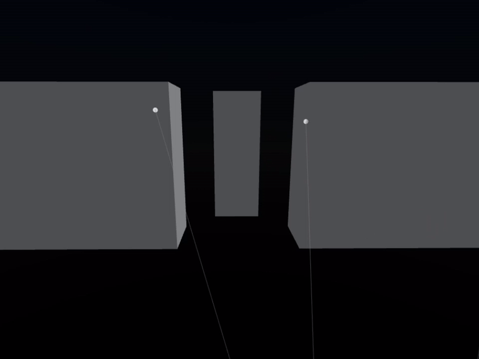

<!--moonwave-hide-before-this-line-->
# RayLens
Raycast and shape cast debugging for Roblox, if you cast the ray, RayLens draws it.

It uses client side handle adornments, so the visuals only exist on your client, other players never see them.
## Install
```toml
[dependencies]
raylens = "superdupernairobi/raylens@0.1.0"
```
Studio users: download `RayLens.rbxm` from the release, right click `ReplicatedStorage` in the Explorer and pick Insert > Import Roblox Model.
## Quickstart
```lua
local rayLens = require(game.ReplicatedStorage.raylens)

local origin = Vector3.new(0, 5, 0)
local direction = Vector3.new(0, -50, 0)

rayLens.draw(origin, direction, workspace:Raycast(origin, direction))
```
The ray appears, sits there for the `lifetime` (default is 8), and then clears itself.
## Notes
- **It does not cast for you.** `draw` takes the result you already have. Pass `nil` and it draws the full length with no marker, so a miss looks different from a hit.
- **Client sided.** Put it in a client script (LocalScript), a server script will look right in studio and do nothing once you play.
- **One shot or per frame.** `draw` called once draws one ray that expires after `lifetime`, for anything moving, use `onDraw` and draw inside the callback.
## API
`draw`, `ray`, `line`, `box`, `sphere`, `cone`, `cylinder`, `clear`, `onDraw` - see the [API reference](https://superdupernairobi.github.io/RayLens/api/RayLens)
## License
MIT